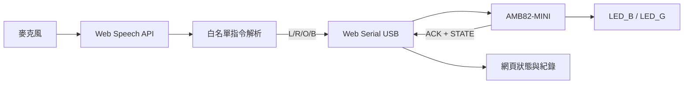

# AMB82-MINI 語音控制 LED

以桌面版 Chrome / Edge 的 Web Speech API 辨識語音，再透過 Web Serial 與 USB 傳送單字元指令到 AMB82-MINI。板端控制內建藍、綠 LED，並回傳 ACK；網頁只有收到回傳後才更新 LED 狀態。

## 硬體與通訊

- 板卡：Realtek AMB82-MINI（RTL8735B / AmebaPro2）
- 藍燈：`LED_B`，PF9，Arduino pin 23
- 綠燈：`LED_G`，PE6，Arduino pin 24
- 亮滅邏輯：本專案依官方 Arduino Blink 寫法，以 `HIGH` 亮、`LOW` 滅；若實機版本相反，只需在 `setLeds()` 對調電位
- 通訊：USB Serial，115200 baud，換行結尾
- 協定：`L/X` 藍燈開/關、`R/Y` 綠燈開/關、`O` 全關、`B` 同時閃爍三次



## 執行方式

1. Arduino IDE 偏好設定加入官方 Boards Manager URL：
   `https://github.com/Ameba-AIoT/ameba-arduino-pro2/raw/main/Arduino_package/package_realtek_amebapro2_index.json`
2. 安裝並選擇 `AmebaPro2 ARM (32-bits) Boards > AMB82-MINI`。
3. 開啟 `VoiceLeftRight.ino`，燒錄到板子。
4. 關閉 Arduino Serial Monitor，避免 COM 埠被占用。
5. 在本資料夾執行 `python server.py`。若電腦的命令是 `py`，改用 `py server.py`。
6. 用桌面版 Chrome 或 Edge 開啟 <http://localhost:8000>。
7. 按「選擇序列埠」，選擇 AMB82-MINI，允許麥克風，再按「開始語音辨識」。
8. 說中文前選擇「中文（台灣）」；說英文前選擇「English (US)」。切換後再按一次「開始語音辨識」。

## 支援指令

| 語音範例 | 傳輸 | 預期結果 |
|---|---:|---|
| 左邊開燈 / blue on | L | 藍燈亮，綠燈維持原狀 |
| 左邊關燈 / blue light off | X | 藍燈滅，綠燈維持原狀 |
| 右邊開燈 / green on | R | 綠燈亮，藍燈維持原狀 |
| 右邊關燈 / green light off | Y | 綠燈滅，藍燈維持原狀 |
| 全部關燈 / turn off the lights | O | 兩燈皆滅 |
| 閃爍三次 / blink 3 times | B | 兩燈同步閃爍三次後熄滅 |

其他語句一律不傳送，LED 保持原狀。若 2 秒內沒有收到 ACK，介面顯示通訊逾時，且不假設 LED 已改變。

「系統紀錄」可隨時重置，或輸出含時間與事件的 UTF-8 CSV，作為驗收測試附件；若目前沒有紀錄，輸出按鈕只會顯示提示而不建立空檔案。

## 驗收紀錄

請在實機完成後填入 `驗收測試紀錄.csv`。建議依序測試：左邊五次、右邊五次、非控制語句一次、拔除 USB 後再送指令一次。

## 自動測試

`test-parser.js` 包含繁簡中文、英文與非控制語句共 12 組案例：

```powershell
node test-parser.js
```

## 專案檔案

- `VoiceLeftRight.ino`：板端韌體與 ACK 協定
- `index.html`：操作介面
- `app.js`：語音辨識、Web Serial、異常處理
- `command-parser.js`：可獨立測試的指令解析器
- `test-parser.js`：解析器測試
- `server.py`：零相依套件的本機伺服器
- `驗收測試紀錄.csv`：現場測試表
- `../output/pdf/0917作業_專題報告.pdf`：繳交報告

## 參考資料

- [Realtek AMB82-MINI Getting Started 與 pin table](https://github.com/Ameba-AIoT/ameba-arduino-doc/blob/main/source/ameba_pro2/amb82-mini/Getting_Started/Getting%20Started%20with%20Ameba.rst)
- [Realtek AmebaPro2 Arduino SDK](https://github.com/Ameba-AIoT/ameba-arduino-pro2)
- [Chrome Web Serial API 說明](https://developer.chrome.com/docs/capabilities/serial)

